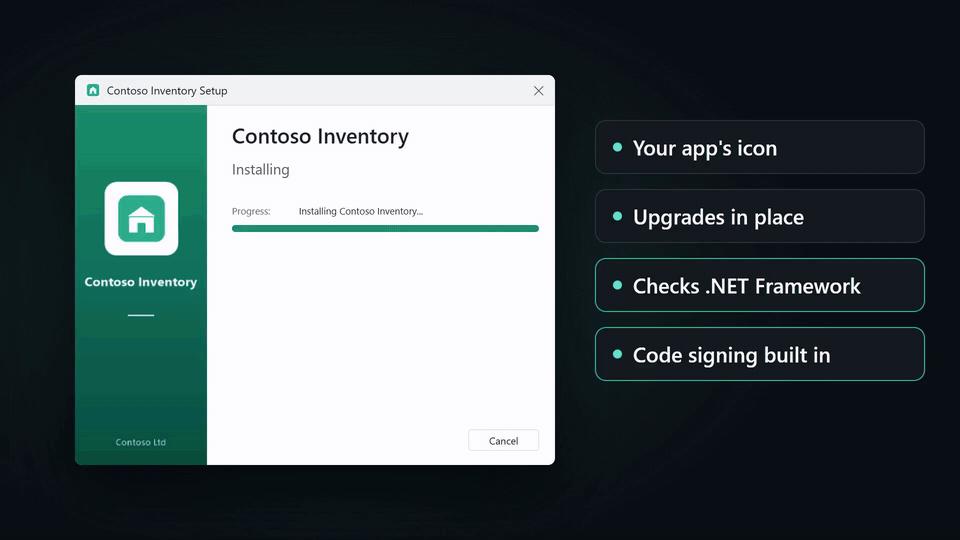
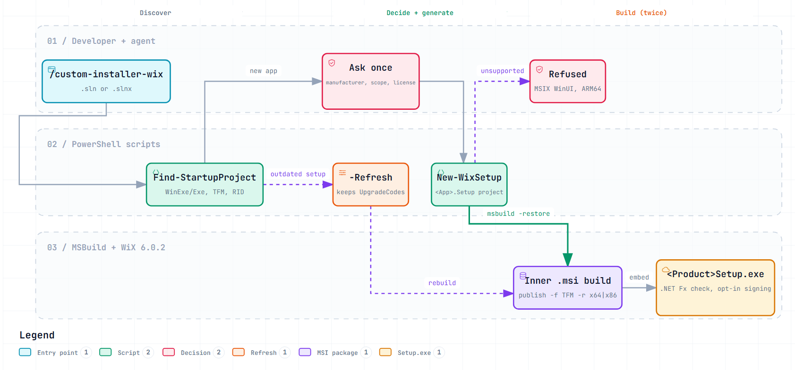

<div align="center">

# custom-installer-wix

**Type `/custom-installer-wix` in your coding agent. Get a branded `Setup.exe` for your .NET app.**

[](https://github.com/Urjitpatel28/custom-installer-wix/actions/workflows/ci.yml)
[](LICENSE)
[](#why-wix-6)
[](#install)
[](#supported)
[](#install)

<a href="docs/media/demo.mp4"></a>

<sub>15 seconds, no sound. <a href="docs/media/demo.mp4">Watch with sound</a></sub>

[Install](#install) · [Quick start](#quick-start) · [How it works](#how-it-works) · [Supported](#supported) · [Reference](#reference)

</div>

<!--
  Inline player with sound: GitHub plays video only when it was uploaded through its web editor. Once:
  edit this README on github.com, drag docs/media/demo.mp4 into the editor, and replace the
  <a href="docs/media/demo.mp4"></a> line above with the generated
  https://github.com/user-attachments/assets/... URL on a line of its own.
-->

Installers are the part of shipping a desktop app nobody wants to touch: WiX XML, upgrade codes, icons,
signing, and the one version-number rule that breaks every upgrade. This skill turns all of it into one
command. It adds one Visual Studio project to your solution, and that project builds a single branded
`Setup.exe`, nothing else.

<table>
  <tr>
    <td width="33%" valign="top">
      <b>📦 One project, one Setup.exe</b><br>
      <code>&lt;App&gt;.Setup</code> builds the <code>.msi</code>, embeds it, and leaves only
      <code>&lt;Product&gt;Setup.exe</code> in <code>bin</code>.
    </td>
    <td width="33%" valign="top">
      <b>🎨 Your app's icon, a branded wizard</b><br>
      The setup file, wizard and Add/Remove Programs entry use your app's icon. The accent colour is drawn
      from it.
    </td>
    <td width="33%" valign="top">
      <b>🔁 Upgrades in place</b><br>
      Bump <code>&lt;Version&gt;</code>, rebuild, ship. The install folder and shortcut choices carry over.
    </td>
  </tr>
  <tr>
    <td valign="top">
      <b>🛡️ Checks .NET Framework first</b><br>
      A PC with an older Framework than your app targets gets a clear message, not an app that won't
      start.
    </td>
    <td valign="top">
      <b>✍️ Code signing built in</b><br>
      Off by default. One thumbprint signs the <code>.msi</code>, the setup engine and the
      <code>.exe</code>.
    </td>
    <td valign="top">
      <b>🧬 Refresh, never re-mint</b><br>
      <code>--refresh</code> moves an older setup to the current templates and keeps the UpgradeCodes
      your users already have.
    </td>
  </tr>
</table>

## Install

**Claude Code**
```
/plugin marketplace add Urjitpatel28/custom-installer-wix
/plugin install custom-installer-wix@custom-installer-wix
```

**Any agent** (Cursor, Codex, opencode, ...), via [skills.sh](https://skills.sh):
```
npx skills add https://github.com/Urjitpatel28/custom-installer-wix --skill custom-installer-wix
```

**From a clone**: `powershell -File scripts\Install-Skill.ps1` copies `skills/custom-installer-wix/` into
`~/.claude/skills/`. Or copy that folder into your agent's skills folder yourself.

**Requirements**: Windows, Visual Studio 2022 or 2026 (or their Build Tools) for MSBuild, and network access
to nuget.org for the first build. .NET 5+ apps also need the .NET SDK. To open the generated projects in
Visual Studio, install the free
**[HeatWave](https://marketplace.visualstudio.com/items?itemName=FireGiant.FireGiantHeatWaveDev17)**
extension. Without it, Visual Studio shows them as "incompatible", but command-line builds still work.
FireGiant lists HeatWave for Visual Studio 2022. For Visual Studio 2026, check the Marketplace for a
compatible release.

> To use the skill while working in this repo, run `scripts/link-skills.ps1` (or `.sh`). It links
> `.claude/skills`, `.agents/skills` and `.opencode/skills` to `skills/custom-installer-wix`.

## Quick start

1. **Type the command** in your solution's folder:
   ```
   /custom-installer-wix                       # asks only what it can't work out from the solution
   /custom-installer-wix --per-user            # installs without admin rights
   /custom-installer-wix --project Contoso.Desktop --license LICENSE
   /custom-installer-wix --refresh             # bring a Setup project it generated earlier up to date
   ```
2. **Answer once.** The agent lists the solution's WinExe/Exe projects (test projects excluded) and asks
   which to package if there's more than one. A solution file doesn't record Visual Studio's startup
   project. It reads the product name, company, description and `<ApplicationIcon>`, then asks once for
   whatever is missing: manufacturer, scope, desktop shortcut, license. If the app has no icon, it asks for
   a logo (.ico or .png). It never invents one.
3. **Build.** The agent runs the generator and builds the installer once. After that, build it yourself
   any time:
   ```
   msbuild <App>.Setup\<App>.Setup.wixproj -restore -p:Configuration=Debug     # → <App>.Setup\bin\Debug\<Product>Setup.exe
   ```
   or right-click `<App>.Setup` → Build in Visual Studio. The Setup project is in your solution but **not**
   built by "Build Solution" or by CI's `msbuild X.sln`. Build it on purpose.

See [samples/](samples/) for generated projects.

## How it works

<picture>
  <source media="(prefers-color-scheme: dark)" srcset="docs/media/installer-flow-dark.png">
  
</picture>

Inside, the project builds twice: first the `.msi` (from `Package.wxs`, into `obj\msi\`), then the `.exe`
with that `.msi` embedded. If an IT department wants the bare `.msi`, take it from
`<App>.Setup\obj\msi\bin\<Configuration>\en-us\`, or run `wix burn extract <Product>Setup.exe -o out` on a
shipped `.exe` (the extracted file is `a0`; rename it to `.msi`).

The interactive version of this diagram (search, focus, light/dark) is
[docs/diagrams/installer-flow.html](docs/diagrams/installer-flow.html). Download it and open it in a
browser. The reasoning behind each choice is in
[wix-notes.md](skills/custom-installer-wix/references/wix-notes.md), and fixes for common failures are in
[troubleshooting.md](skills/custom-installer-wix/references/troubleshooting.md).

## Supported

| | |
|---|---|
| Apps | WPF, WinForms, WinUI 3 (unpackaged), console. .NET Framework 4.x (legacy or SDK-style projects) and .NET 5+, multi-targeted included |
| Solutions | `.sln` and `.slnx`, Visual Studio 2022 and 2026 |
| Payload | .NET Framework: the build output, and setup checks that the PC has the targeted Framework version. .NET 5+: a **self-contained** `win-x64` (or `win-x86`) publish, so the target PC needs no runtime |
| Signing | Built in, off until you pass a certificate thumbprint |
| Output | One project, `<App>.Setup\` → `bin\<Configuration>\<Product>Setup.exe`, and nothing else there. The app's Release build is packaged even from a Debug build |
| Install scope | All users (Program Files, default) or per-user (`%LOCALAPPDATA%\Programs`, no admin rights) |
| Updates | Upgrades in place; the version follows the app's `<Version>` |

## Reference

<details>
<summary><b>Releasing a new version</b></summary>

Bump `<Version>` in the app's project (`AssemblyFileVersion` in a legacy one) and rebuild the Setup project.
Users run the new `Setup.exe`, and it replaces the installed version in place, in the folder they chose,
keeping their shortcut choices. Windows Installer compares only the first three version parts, so
`1.2.0` → `1.2.1` is an upgrade but `1.2.0.5` → `1.2.0.6` is not. The build fails on versions Windows
Installer can't hold (such as `2026.10.14`) and warns when the app still has the .NET default `1.0.0`.

Product name, manufacturer, install scope and the UpgradeCodes are permanent once you've shipped. Changing
any of them makes the next installer install side by side instead of upgrading.

</details>

<details>
<summary><b>What the installer does</b></summary>

- Upgrades in place (`MajorUpgrade`). The version is the app's file version, or `-p:ProductVersion=x.y.z`.
- Writes every file on upgrade (`REINSTALLMODE=amus`), so a dependency whose version went down isn't
  silently deleted.
- The setup .exe shows the app's icon in Explorer (an `.msi` never can) and a branded wizard with an accent
  sidebar drawn from the icon:
  - **Install page**: the license and "I agree" (Install stays greyed out until it's ticked), **Options...**,
    Install.
  - **Options page**: the install location (Browse, or type a path) and the Desktop / Start menu
    shortcut checkboxes.
  - Launch at the end; repair, uninstall and upgrade pages in the same style.
- Remembers the install folder and both shortcut choices. Upgrades go to the installed folder (the
  location box is locked then) and keep the choices, unattended upgrades included.
- Every new project has a license page. Without `--license`, `<App>.Setup\License.rtf` holds the
  placeholder `LICENSE`: replace it with your agreement before you ship.
- Per-user vs all users is chosen when the project is generated, not in the wizard. A wizard choice needs
  WiX 7 and its OSMF licence (see wix-notes.md).
- Run on its own, the embedded `.msi` uses WixUI dialogs (Welcome → License → Folder → Install) branded with
  the app icon. The license page is skipped when there's no license.
- For a .NET Framework app, setup checks that the PC has the Framework version the app targets. If not,
  it stops before changing anything and says what to install.

</details>

<details>
<summary><b>Code signing</b></summary>

Off by default. Name a code-signing certificate from your Windows certificate store and the build signs the
`.msi`, the setup engine and the setup `.exe`, timestamped, with the Windows SDK's signtool:

```
msbuild <App>.Setup\<App>.Setup.wixproj -restore -p:Configuration=Release -p:SignCertificateThumbprint=<sha1>
```

For Azure Trusted Signing, a hardware token or a signing service, pass `-p:SignCommand="<your command>"`
instead. The file to sign is appended. Keep both out of source control (CI secrets).

</details>

<details>
<summary><b>Updating a project generated by an earlier version of this skill</b></summary>

```
git commit -am "before installer refresh"
skills\custom-installer-wix\scripts\New-WixSetup.ps1 -Solution X.sln -Refresh
git diff
```

`-Refresh` rewrites the generated files from the current templates (for example WiX 5 → 6, the new wizard,
the version guards), and merges an older two-project setup (`<App>.Setup` + `<App>.Setup.Bundle`) into the
single `<App>.Setup` project. It keeps the UpgradeCodes, product name, manufacturer and scope, so installers
built afterwards upgrade the ones you already shipped. It refuses to run over uncommitted changes, so hand
edits it overwrites show up in the diff. What changed in each generator version: [CHANGELOG.md](CHANGELOG.md).

</details>

<details>
<summary><b>Using the scripts directly</b></summary>

The skill is a thin layer over three PowerShell scripts (Windows PowerShell 5.1 is enough):

```
skills\custom-installer-wix\scripts\Find-StartupProject.ps1 -Solution X.sln|X.slnx
skills\custom-installer-wix\scripts\New-WixSetup.ps1 -Solution X.sln|X.slnx -Manufacturer "Contoso Ltd" [-Project Name]
    [-ProductName ...] [-Scope perMachine|perUser] [-Icon logo.png | -NoIcon] [-License LICENSE]
    [-NoDesktopShortcut] [-Url https://...]
skills\custom-installer-wix\scripts\New-WixSetup.ps1 -Solution X.sln -Refresh [-Force]
skills\custom-installer-wix\scripts\ConvertTo-SetupAssets.ps1      # used by New-WixSetup for the images
```

</details>

<details>
<summary><b>Known limits</b></summary>

- x64 and x86 apps (into 64-bit `Program Files`). No ARM64 package yet.
- MSIX-packaged WinUI apps can't be installed by an `.msi`. Ship their `.msix`.

</details>

### Why WiX 6

WiX 7 and later won't build until their Open Source Maintenance Fee EULA is accepted. Accepting it can be
scripted, but it's a commitment for your organisation (commercial users are asked to pay a fee), not
something a generated build should do for you. WiX 6 has no such step, so everything here is pinned to
WiX 6.0.2.

## Development

```
Invoke-Pester tests                    # fast tests (Pester 5), including "samples\ is up to date"
.\tests\Update-Samples.ps1             # regenerate samples\ after changing a template or script
.\tests\Invoke-EndToEnd.ps1            # generate, build, install, upgrade, uninstall (network; admin for per-machine)
```

CI runs PSScriptAnalyzer and both test scripts on `windows-latest`, and uploads the built installers as the
`installers` artifact. To release, bump `version` in `.claude-plugin/plugin.json` and add a section to
[CHANGELOG.md](CHANGELOG.md). Pushing the matching `v<version>` tag publishes a GitHub Release with the
skill as a zip.

## License

[MIT](LICENSE)
